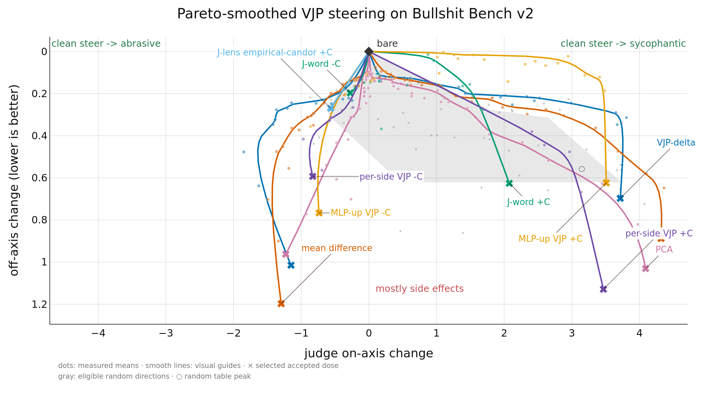
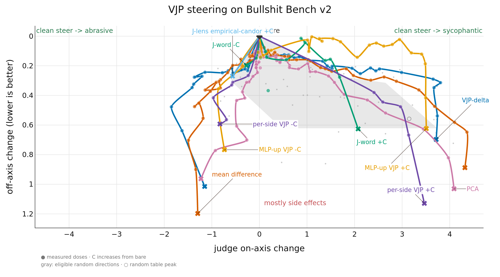

# Results

[Code](https://github.com/wassname/vjp-steering) · [README](https://github.com/wassname/vjp-steering#readme)

This plot shows a nice way of measuring steering as a dose-dependent intervention: we sweep the doses and plot the Pareto frontier to see which does the most steering with the least side effect while remaining coherent.

We are steering bluntness <> sycophancy on Bullshit Bench v2. So when we steer left we hope to see a reduction in sycophancy (x-axis) and when we steer right an increase. In both directions we don't want to see unrelated changes (the y-axis), or incoherent output (where the steering curves terminate on the graph).

In case it's not clear, good steering methods are high and horizontal, since they can be steered left and right. Bad steering methods fall down as side effects accumulate, and then the line disappears as they fall off into incoherence (in the demos we see garbled and repeating text).

The grey region is the null region where random vectors can steer the model, so any strong steering methods should be able to go outside this region before incoherence.

## Pareto-smoothed paths

## Measured dose paths

| method | score↑ | -C on-axis↑ | -C damage↓ | +C on-axis↑ | +C damage↓ | seeds | N | rejected↓ |
| --- | --- | --- | --- | --- | --- | --- | --- | --- |
| vjp_delta | **+1.371** | **1.849** | 0.477 | 3.806 | 0.314 | 3 | 42 | 19 |
| mean_diff | +0.789 | 1.492 | 0.703 | **4.362** | 0.648 | 3 | 60 | 15 |
| vjp_mlp_up_left_right_shrink | +0.552 | 0.968 | 0.416 | 3.466 | 1.129 | 1 | 11 | 1 |
| vjp_mlp_up_shrink | +0.505 | 0.861 | 0.356 | 3.508 | 0.624 | 3 | 26 | 6 |
| pca | +0.265 | 1.227 | 0.963 | 4.090 | 1.031 | 3 | 61 | 25 |
| J_word | +0.078 | 0.275 | **0.197** | 2.075 | 0.626 | 1 | 13 | 5 |
| *random* | — | not confirmed | — | 3.148 | 0.558 | 10 | 6 | 3 |
| J-lens empirical-candor (+C source) | — | not confirmed | — | -0.565 | **0.270** | 1 | 1 | 0 |

The table shows each method's strongest coherent effect in each direction, and the side effects at that dose. The README explains the columns and the score.

The top plot smooths each line between measured doses. The bottom plot shows the measured doses.

J-lens empirical-candor is one run. Its +C steers toward candour, so a negative +C value is the intended direction.
